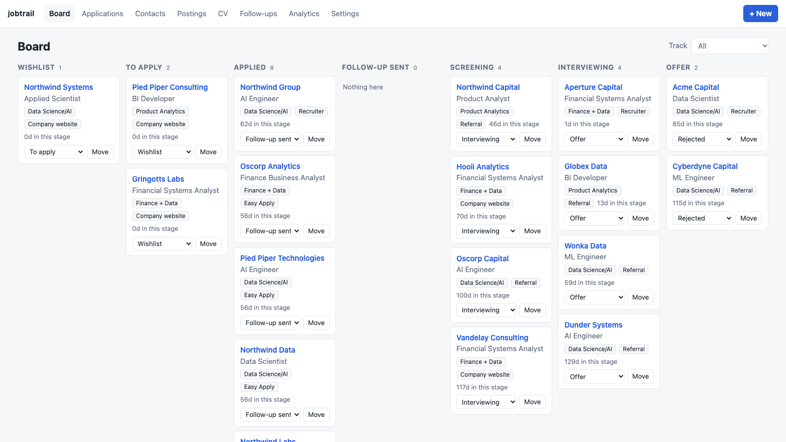
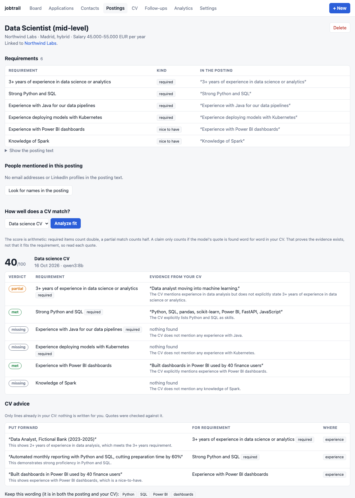
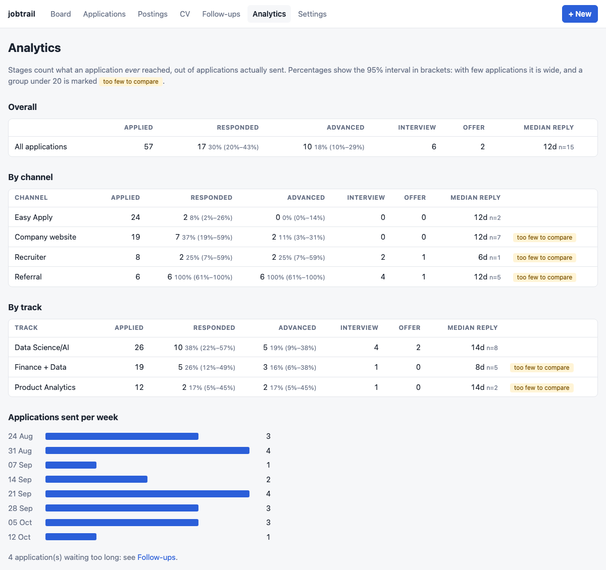
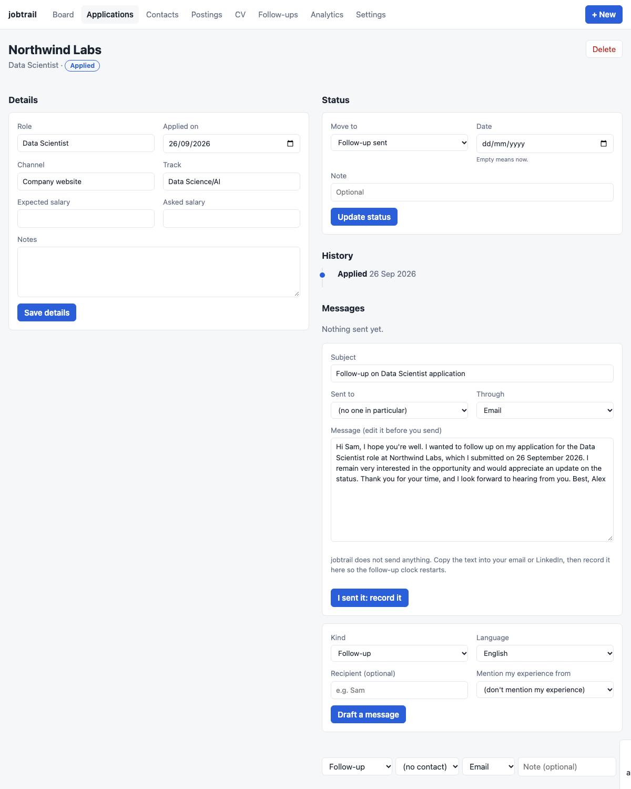

# jobtrail

[](https://github.com/AlvaroVerona/jobtrail/actions/workflows/ci.yml)

A local-first job search tracker. It records every application with a reliable status history, shows which channel, track and CV version actually get replies (and says plainly when there is too little data to tell), and uses a **local** LLM to compare postings with your CV and draft follow-ups, without letting the model make things up. No accounts, no cloud, no paid APIs.



## Why

Applying in volume (LinkedIn Easy Apply, say) leaves you with a spreadsheet of "Applied" rows and no signal on what works. jobtrail is built for a targeted search: fewer applications, each tracked, with analytics that report the sample size next to every percentage, and AI help that is checked by code instead of trusted.

## What it does

| | |
|---|---|
| **Track** | A board and a table with a full status history (wishlist, applied, follow-up sent, screening, interviewing, offer, rejected, no response, withdrawn). Channels and tracks are yours to define. |
| **Measure** | Funnel by channel and track with 95% intervals, median days to a reply, applications waiting too long, and a weekly activity chart. Groups under 20 applications are flagged *too few to compare*. |
| **Match** | Paste a posting: its requirements are extracted. Compare it with a CV version: each requirement is *met / partial / missing*, with the exact words of your CV that back it. |
| **Advise** | Which existing CV lines to put forward for a posting, which wording to keep, and which requirements your CV does not evidence (so you do not claim them). |
| **Write** | Draft a follow-up, thank-you or recruiter intro in English or Spanish. jobtrail sends nothing: you edit, send it yourself, and record it so the waiting clock restarts. |
| **Keep in touch** | A light CRM: the people you write to, what was said, whether they answered, and reminders to look again. See [Contacts and reminders](#contacts-and-reminders-a-light-crm). |



## Quick start

Requires Python 3.12+ and [uv](https://docs.astral.sh/uv/). The AI features also need [Ollama](https://ollama.com) with a model (`ollama pull qwen3:8b`); everything else works without it.

```bash
git clone https://github.com/AlvaroVerona/jobtrail.git
cd jobtrail
uv sync

uv run jobtrail demo                                  # synthetic data, in its own database
JOBTRAIL_DB_FILE=demo.db uv run jobtrail serve        # http://127.0.0.1:8000
```

With your own data:

```bash
uv run jobtrail serve                                 # starts empty
uv run jobtrail import-csv applications.csv --dry-run # preview an import, writes nothing
uv run jobtrail import-csv applications.csv
uv run jobtrail stats                                 # the analytics in the terminal
```

`import-csv` needs a `Company` column; optional: `Role`, `Status`, `Applied date`, `Channel`/`Canal`, `Track`, `Expected salary`, `Asked salary`, `Response date`/`Fecha respuesta`, `Notes`. Headers are matched case-insensitively in English or Spanish, so a Notion database exported as CSV works as is. Dates may be `2026-05-19`, `19/05/2026` (day first) or `May 19, 2026`. Importing a file twice is safe, and bad rows are reported without stopping the import. Sample inputs for the AI features are in `src/jobtrail/demo_data/`.



## How the AI features stay honest

A small local model will happily write something plausible and false, so the model is never the authority. It proposes; code checks.

* **Evidence must exist.** For each requirement the model gives a verdict and a quote from your CV. The quote is searched for, as whole words, in your CV text. A claim whose quote is not there is downgraded to *missing* and flagged on screen, and the invented quote is never shown. Whole-word matching matters: a CV that says "JavaScript" does not satisfy "Java".
* **The score is arithmetic**, not a number the model chose: required items count double, a partial counts half.
* **Drafts are scanned.** Every number and every proper noun or acronym in a draft must appear in your CV or the application data, otherwise the draft goes back to the model, and on the last attempt it is shown with a warning. The posting's requirements are deliberately withheld from the drafter, because in testing the model presented them as the candidate's own experience.
* **Advice follows the analysis.** CV advice is only offered for requirements the fit analysis found support for, and what the CV does not evidence is reported by code.

Each of these guards was disabled on purpose, one at a time, to check that a test fails; and the two failure modes above were found by running the real model, not by the tests ([`docs/decisions/0002-outreach-guards.md`](docs/decisions/0002-outreach-guards.md)). The model choice is documented with its evidence in [`docs/decisions/0001-default-model.md`](docs/decisions/0001-default-model.md).



**What this does not guarantee.** A matching quote proves the words are in your CV, not that they fit the requirement; the page puts every quote beside its requirement so you can judge. A one-letter skill such as "R" can only be cited through a longer line. The draft scan catches invented numbers and capitalised names, not lower-case terms or claims in plain words. **Read every draft before you send it.**

## Privacy and security

Your CV, postings and applications live in a SQLite file on your machine (`data/`, git-ignored). The only network traffic is to Ollama on localhost, and nothing is sent anywhere else. jobtrail never fetches a posting or scrapes a site: you paste what you want it to read.

The web app only answers requests addressed to localhost and refuses state-changing requests that come from another site, so a page you happen to visit cannot edit your data (CSRF and DNS rebinding). All text from postings, CVs and the model is HTML-escaped, and posting links are limited to `http(s)`.

## Configuration

Environment variables or a `.env` file (see `.env.example`).

| Variable | Default | |
|---|---|---|
| `JOBTRAIL_DATA_DIR` | `data` | where the database lives |
| `JOBTRAIL_DB_FILE` | `jobtrail.db` | database file name |
| `JOBTRAIL_HOST` / `JOBTRAIL_PORT` | `127.0.0.1` / `8000` | |
| `JOBTRAIL_OLLAMA_MODEL` | `qwen3:8b` | any model Ollama has |
| `JOBTRAIL_OLLAMA_HOST` | `http://localhost:11434` | |
| `JOBTRAIL_OLLAMA_NUM_CTX` / `_TIMEOUT` | `8192` / `300` | context tokens / seconds |
| `JOBTRAIL_STALE_AFTER_DAYS` | `21` | when an application counts as waiting too long |
| `JOBTRAIL_MIN_SAMPLE` | `20` | applications needed before a group is compared |
| `JOBTRAIL_PARENT_PID` | unset | set by the macOS app: the server exits when that process does |

## Development

```bash
uv sync
uv run ruff check . && uv run ruff format --check .
uv run pytest                          # 405 tests, none of them calls a real model
(cd macos && swift test)               # 39 tests for the macOS app (macOS only)
uv run python scripts/compare_models.py qwen3:8b llama3.1   # live model comparison (needs Ollama)
uv run python scripts/screenshots.py   # regenerate docs/images (needs Ollama and Chrome)
```

Tests are hermetic: model calls go through a scripted `FakeLLM`. [`docs/ARCHITECTURE.md`](docs/ARCHITECTURE.md) maps the code; [`docs/DESIGN.md`](docs/DESIGN.md) is the original design record (in Spanish), kept as written with its decisions updated.

## Status

Working end to end for a single user on one machine. Not built, on purpose: multi-user hosting, scraping portals, sending messages for you. Known gaps: no follow-up *scheduling* (you record the ones you send), one CV text per version (a scanned PDF has no text to read), and the model evidence in `docs/decisions/` comes from one synthetic case.

## License

MIT
